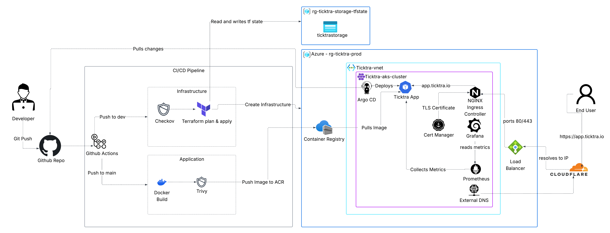

# K8s-Ticktra
Ticktra on Kubernetes. An IT helpdesk platform on Azure Kubernetes Service (AKS), built with Terraform and deployed through GitOps.

## Overview

Ticktra is an IT helpdesk platform built to run on **Azure Kubernetes Service (AKS)** with deployments driven entirely by GitOps. The whole Azure environment is defined in **Terraform** from the network, cluster to identity and the **Azure Container Registry (ACR)** that holds the app’s docker images. GitHub Actions takes care of the pipelines so a code change can go live without anyone touching the cluster by hand.

Users reach the app at app.ticktra.io over HTTPS through the NGINX Ingress Controller. Behind the scenes, the platform looks after itself:

- Cert-manager requests certificates from Let’s Encrypt and renews them before they expire
- ExternalDNS writes the DNS records to Cloudflare whenever a new route is added
- Helm installs the supporting tools in a consistent, repeatable way
- ArgoCD watches the Git repo, rolls out new versions, and reverses any changes made outside of Git
- Prometheus and Grafana track the health of the cluster and the app, with a dashboard built specifically for Ticktra

## Architecture



*Click the diagram to view it full size.*

The diagram shows two journeys through the platform.

**From code to production (left to right)**

1. A developer pushes code to **GitHub**, which triggers **GitHub Actions**.
2. **Infrastructure:** Checkov scans the Terraform code then Terraform creates or updates the Azure resources. Its state is stored separately in its own resource group.
3. **Application:** the Docker image is built, scanned with Trivy for security vulnerabilities and pushed to the **Azure Container Registry**.
4. **ArgoCD** running inside the AKS cluster pulls the changes from GitHub and deploys the new version. The AKS cluster pulls the image from the Azure Container Registry.

**From user to app (right to left)**

1. A user visits **app.ticktra.io**. **Cloudflare** resolves the name to the cluster's public IP.
2. The **Azure Load Balancer** accepts traffic on ports 80 and 443 only.
3. The **NGINX Ingress Controller** handles HTTPS and routes the request to the **Ticktra app**.

**Supporting services inside the cluster**

- **cert-manager** provides the TLS certificate that NGINX uses
- **ExternalDNS** keeps the Cloudflare DNS records up to date
- **Prometheus** collects metrics from the app, and **Grafana** displays them

## Key components

| Component | Role |
| --- | --- |
| **Terraform** | Builds all Azure infrastructure as code: networking, AKS, ACR and Entra ID groups |
| **Azure Kubernetes Service (AKS)** | Runs the Ticktra app and the platform tools |
| **Azure Container Registry (ACR)** | Stores the app's Docker images |
| **GitHub Actions** | Runs the CI/CD pipelines for infrastructure and the app |
| **Checkov** | Scans the Terraform code for security misconfigurations |
| **Trivy** | Scans each Docker image for vulnerabilities before it's pushed |
| **ArgoCD** | Deploys the app from Git and keeps the cluster in sync |
| **NGINX Ingress Controller** | Routes incoming traffic to the app and handles HTTPS |
| **cert-manager** | Gets and renews TLS certificates from Let's Encrypt |
| **ExternalDNS** | Creates and updates DNS records in Cloudflare automatically |
| **Microsoft Entra ID** | Controls who can access the cluster |
| **Prometheus** | Collects metrics from the cluster and the app |
| **Grafana** | Displays the metrics in dashboards |


## Project Structure

```
K8s-Ticktra/
├── .github/
│   └── workflows/
│       ├── build-push.yml            # Build, smoke test, Trivy scan, push to ACR, update image tag
│       ├── terraform-plan.yml        # Checkov + plan on push to dev, opens a PR
│       ├── terraform-apply.yml       # Applies on merge to main
│       └── terraform-destroy.yml     # Manual teardown
├── docs/
│   └── architecture.png              # Architecture diagram
├── k8s/
│   ├── addons/
│   │   ├── dashboards/
│   │   │   └── ticktra-app.json      # Grafana dashboard
│   │   ├── cluster-issuers.yml       # cert-manager ClusterIssuers
│   │   ├── external-dns-values.yml   # ExternalDNS Helm values
│   │   └── monitoring-values.yml     # Prometheus/Grafana Helm values
│   ├── app/
│   │   ├── deployment.yml
│   │   ├── service.yml
│   │   └── ingress.yml
│   └── argocd/
│       └── ticktra-app.yml           # Argo CD Application
├── terraform/
│   ├── bootstrap/                    # Remote state backend setup
│   │   ├── main.tf
│   │   ├── outputs.tf
│   │   ├── providers.tf
│   │   └── variables.tf
│   ├── modules/
│   │   ├── acr/                      # Azure Container Registry
│   │   ├── aks/                      # AKS cluster with Entra ID login
│   │   ├── identity/                 # Entra ID admin and read-only groups
│   │   └── networking/               # VNet, subnets and NSGs
│   ├── backend.tf
│   ├── main.tf
│   ├── outputs.tf
│   ├── providers.tf
│   └── variables.tf
├── ticktra-flask/
│   ├── static/
│   │   └── index.html                # Frontend
│   ├── app.py                        # Flask application
│   ├── models.py                     # Database models
│   ├── requirements.txt
│   ├── Dockerfile
│   ├── .dockerignore
│   └── README.md
├── .gitignore
├── .trivyignore
├── LICENSE
└── README.md

```